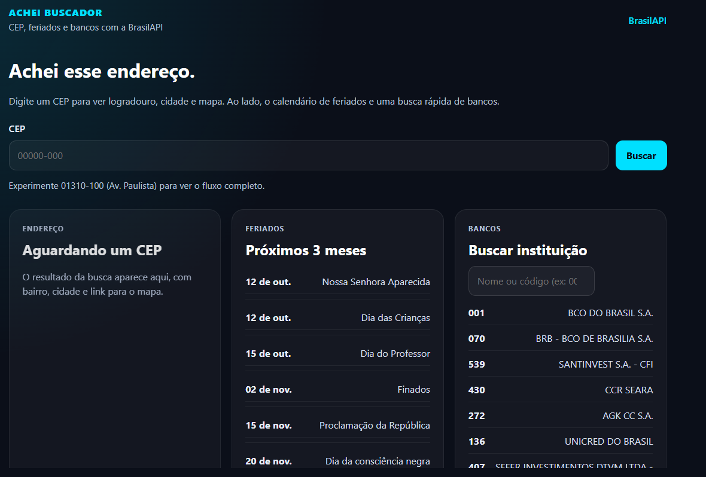

# Achei Buscador

Consulta de CEP, feriados e bancos com a [BrasilAPI](https://brasilapi.com.br/). Feito em React, no visual do portfólio.

**Ao vivo:** [achei-buscador.vercel.app](https://achei-buscador.vercel.app/)



## Funcionalidades

- Busca de endereço por CEP, com cópia e link para o mapa
- Histórico dos últimos CEPs no navegador
- Lista de feriados e datas especiais nos próximos 3 meses
- Calendário mensal (feriado nacional vs data comemorativa)
- Busca rápida de bancos por nome ou código

## Stack

- React + Vite
- CSS
- [BrasilAPI](https://brasilapi.com.br/)

## Como rodar

```bash
npm install
npm run dev
```
